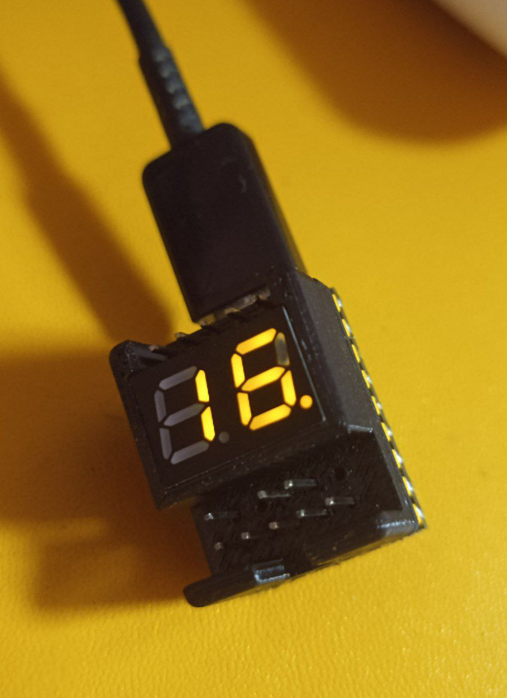
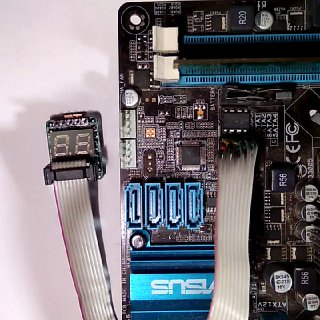
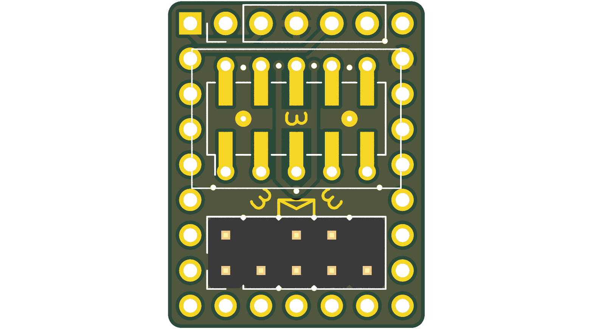
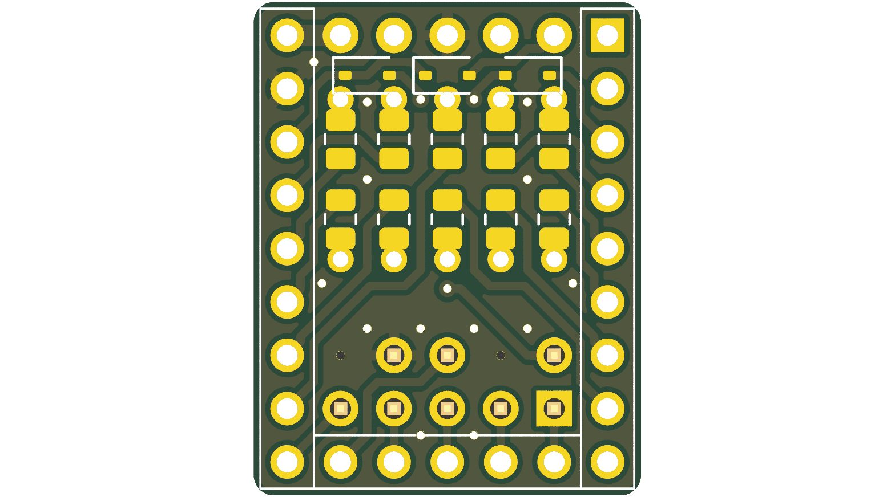
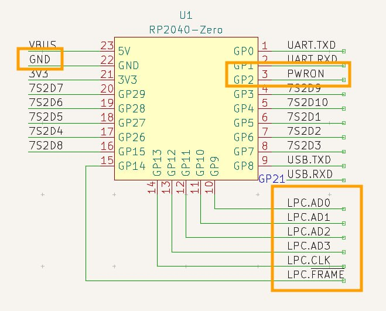

# PicoPost

**English** | [Русский](README_ru.md)

**Compact RP2040-based BIOS POST Code Reader & LPC Bus Sniffer**

[](LICENSE)
[](hardware/)
[](https://www.raspberrypi.com/documentation/microcontrollers/rp2040.html)
[](https://github.com/jeffangelion/PicoPost/releases/latest)

<p align="center">
  
  
</p>

---

## 📖 About The Project

**PicoPost** is an open-source hardware and firmware solution for capturing and displaying BIOS diagnostic POST codes from PC motherboards over the **LPC (Low Pin Count)** bus.

Built in an ultra-compact form factor (~18.4 × 23.5 mm) around the **Raspberry Pi RP2040** microcontroller (Waveshare RP2040-Zero module or pin-compatible clones).

### Key Features:
- **Hardware LPC Sniffing at 33 MHz:** Utilizes the RP2040 Programmable I/O (PIO) state machine with the system clock overclocked to 198 MHz (33 MHz × 6) to reliably capture LPC I/O port `0x80` write cycles.
- **Dynamic 2-Digit 7-Segment LED Display:** Real-time HEX display of BIOS initialization and error codes. Dynamic multiplexing and PWM brightness control run asynchronously on **Core 1**, ensuring smooth, flicker-free rendering with zero impact on LPC bus capture.
- **Multi-Model Display Support:** Firmware supports popular common-cathode and common-anode dual 7-segment displays (`_2281BY`, `KL2821B`, `E20281I`, `E20281L`).
- **Multi-Vendor Motherboard Header Compatibility:**
  - Standard LPC (2×5 pin, 2.54 mm pitch)
  - ASUS LPC (10-pin TPM / Debug header)
  - Gigabyte LPC (12-pin header)
  - ASUS eLPC (12-pin single-row header)
- **Power State Detection (PWRON):** A dedicated sensing input on GP2 (connected to +3.3V LPC) detects motherboard power transitions (`PON` / `POF`) and automatically blanks the display when power is turned off.
- **Dual Logging (Dual UART / USB Serial):** Streams POST codes to a PC terminal via USB CDC serial (`/dev/ttyACM*`) and over hardware UART (GP0/GP1) for automated test benches and diagnostic logging.
- **3D-Printable Enclosure:** Solid model (`.step`) provided for 3D printing a custom protective snap-fit case (FDM / SLA).
- **Ready-to-Flash Releases (`.uf2`):** Pre-compiled firmware binaries are available on the [GitHub Releases](https://github.com/jeffangelion/PicoPost/releases/latest) page for instant drag-and-drop installation.

---

## 🖼️ Hardware Design (PCB)

The PCB is designed as a sandwich module: the RP2040-Zero is soldered directly flat onto the castellated pads on the bottom layer, SMD resistors and protection diodes are mounted inside, while the dual 7-segment display and pin headers are placed on the top layer.

<p align="center">
  
  &nbsp;&nbsp;&nbsp;&nbsp;
  
</p>

- Complete KiCad 8 project files: [`hardware/kicad/`](hardware/kicad/).
- Ready-to-order Gerbers ZIP: [`hardware/gerbers/PicoPost_Gerbers.zip`](hardware/gerbers/PicoPost_Gerbers.zip).
- Schematic in PDF: [`hardware/PicoPost_Schematic.pdf`](hardware/PicoPost_Schematic.pdf).
- 3D-printable case model: [`hardware/enclosure/PicoPost_Case.step`](hardware/enclosure/).

---

## 🔌 Pinout & Wiring Guide

<p align="center">
  
</p>

### LPC Bus Signals (to RP2040):
- **LPC.AD0** → GP9
- **LPC.AD1** → GP10
- **LPC.AD2** → GP11
- **LPC.AD3** → GP12
- **LPC.CLK** (33 MHz) → GP13
- **LPC.FRAME#** → GP14
- **PWRON** (Power Detect) → GP2 (connect to +3.3V LPC)
- **GND** → Motherboard ground
- **3.3V** → 3.3V power from the LPC header (or via USB Type-C)

> [!TIP]
> Detailed pinout tables for **ASUS 10-pin**, **Gigabyte 12-pin**, and **ASUS eLPC 12-pin** headers are documented in [`docs/pinouts.md`](docs/pinouts.md).

---

## ⚡ Quick Start (Flashing Firmware)

### Method 1: USB Mass Storage (BOOTSEL)
1. Download the latest **`PicoPost.uf2`** from the [GitHub Releases](https://github.com/jeffangelion/PicoPost/releases/latest) page.
2. Hold down the **BOOT** (BOOTSEL) button on the RP2040-Zero module and plug it into your computer via a USB Type-C cable.
3. The board will appear as a removable drive named `RPI-RP2`.
4. Drag and drop `PicoPost.uf2` onto the `RPI-RP2` drive.
5. The device will reboot automatically and start running!

### Method 2: Via `upload.sh` script (picotool)
```bash
cd firmware
./upload.sh
```

---

## 🛠️ Building From Source

### Prerequisites
- CMake (>= 3.17)
- GNU Arm Embedded Toolchain (`arm-none-eabi-gcc`, `arm-none-eabi-g++`)
- Raspberry Pi Pico SDK

### Build Instructions
```bash
# 1. Specify the path to your Pico SDK (if not globally configured):
export PICO_SDK_PATH=/path/to/pico-sdk

# 2. Navigate to the firmware directory and execute the build script:
cd firmware
./build.sh
```
The compiled binary will be placed at `firmware/build/PicoBiosPostCodeReader.uf2`.

---

## ⚙️ Configuration (`Settings.h`)

All pin mappings, 7-segment display models, brightness levels, and baud rates can be configured in [`firmware/src/Settings.h`](firmware/src/Settings.h):

```c
// Select display model:
#define DISPLAY _2281BY
// #define DISPLAY KL2821B
// #define DISPLAY E20281I
// #define DISPLAY E20281L

// Display brightness (0x00 - 0xFF) and segment timing:
#define DISPLAY_BRIGHTNESS  (0xFF / 2)
#define DISPLAY_SEGTIME_US  500

// UART logger baud rate:
#define PUART_BAUDRATE   115200
```

---

## 🧩 Bill of Materials (BOM)

| Ref Des | Component / Value | Package | Qty |
|:---|:---|:---|:---:|
| **U1** | RP2040-Zero (Waveshare or clone) | Castellated SMD | 1 |
| **U2** | 2-Digit 7-Segment Display | 10-pin 15×14 mm / 15×10 mm | 1 |
| **R1–R10** | 36 Ω (33–68 Ω) | SMD 0805 | 10 |
| **D1–D3** | 1N5819WS (Schottky) | SOD-323 | 3 |
| **J2** | Pin Header 1×5 2.54 mm (UART) | THT Vertical | 1 |
| **J3** | Pin Header 2×5 2.54 mm (LPC) | THT Vertical | 1 |

For detailed assembly instructions, see [`docs/bom.md`](docs/bom.md).

---

## 📂 Repository Structure

```
PicoPost/
├── docs/                      # Documentation, pinout tables, BOM and media
│   ├── images/                # Hardware photos, 3D renders, schematics
│   ├── pinouts.md             # Multi-vendor LPC header pinouts
│   └── bom.md                 # Bill of Materials
├── firmware/                  # Firmware source code
│   ├── src/                   # C source files and PIO assembly
│   │   ├── Display/           # Core 1 dynamic 7-segment display driver
│   │   ├── LPCPwrDet/         # LPC PWRON power state monitor
│   │   ├── LPCSniffer/        # PIO-based LPC bus sniffer
│   │   ├── lpc_bus_sniffer.pio# PIO assembly program for LPC frames
│   │   ├── Main.c             # Main entry point & multicore launcher
│   │   └── Settings.h         # Hardware pins, clock, and display configuration
│   ├── CMakeLists.txt         # CMake build configuration
│   └── build.sh / upload.sh   # Build and flash automation scripts
├── hardware/                  # Hardware design files (KiCad 8)
│   ├── kicad/                 # KiCad schematics, PCB layout, footprints
│   ├── gerbers/               # Gerber & drill files, ready-to-order ZIP
│   ├── enclosure/             # 3D-printable case model (STEP)
│   └── PicoPost_Schematic.pdf # PDF schematic export
├── LICENSE                    # Apache License 2.0
├── NOTICE                     # Copyright notices
├── README.md                  # Main documentation (English)
└── README_ru.md               # Документация (Русский)
```

---

## 📜 License & Credits

- This project is distributed under the **Apache License 2.0**. See [LICENSE](LICENSE) and [NOTICE](NOTICE) for details.
- Original hardware design (schematics, PCB), firmware modular architecture, and 7-segment display driver authored by **🦊**. Repository prepared, maintained, and published by [jeffangelion](https://github.com/jeffangelion).
- LPC bus sniffer algorithm based on [RasPiPicoSDK-PicoBiosPostCodeReader](https://github.com/MrGreensWorkshop/RasPiPicoSDK-PicoBiosPostCodeReader) by **Mr. Green's Workshop** ([https://www.MrGreensWorkshop.com](https://www.MrGreensWorkshop.com)).
