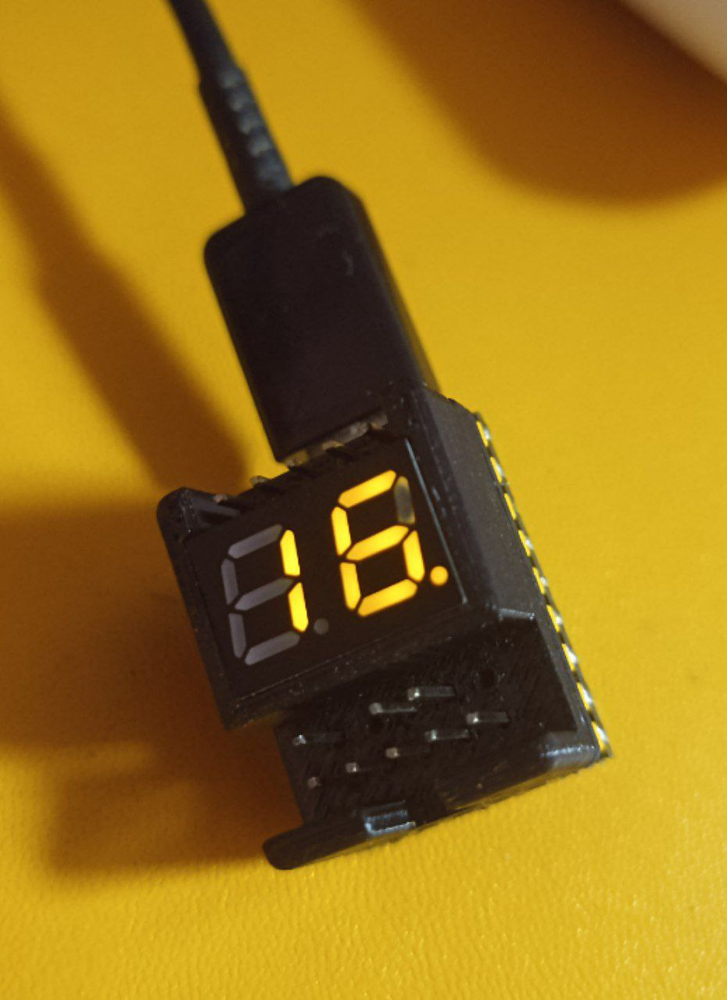
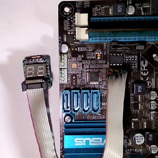
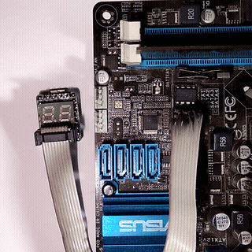
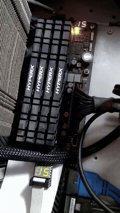
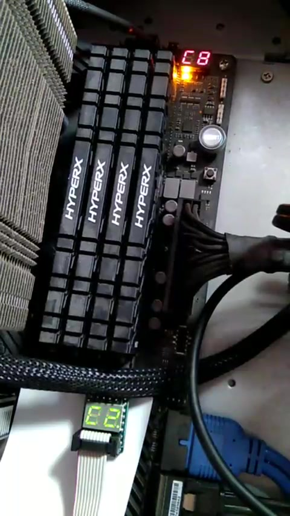
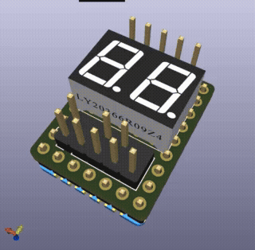
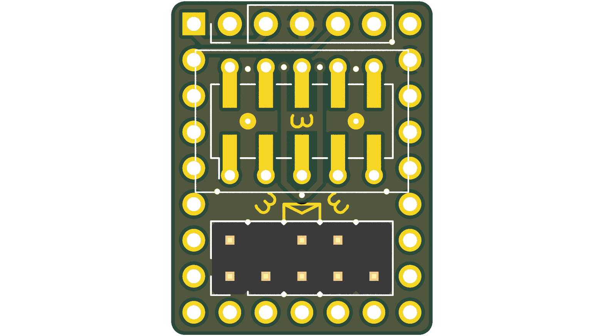
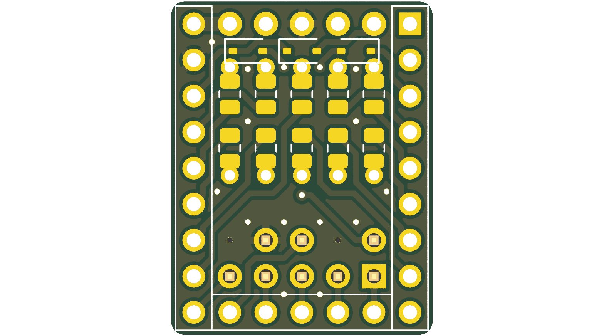
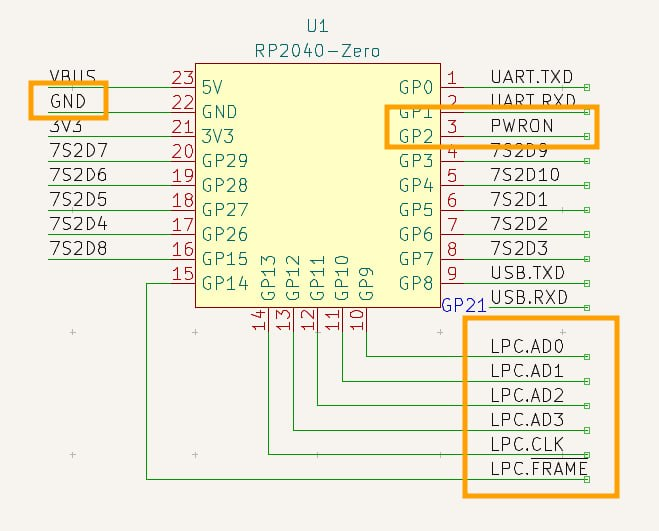

# PicoPost

[English](README.md) | **Русский**

**Компактный POST-код ридер и LPC-сниффер на базе Raspberry Pi RP2040**

[](LICENSE)
[](hardware/)
[](https://www.raspberrypi.com/documentation/microcontrollers/rp2040.html)
[](https://github.com/jeffangelion/PicoPost/releases/latest)

<p align="center">
  
  
</p>

---

## 📖 О проекте

**PicoPost** — это открытый аппаратно-программный комплекс для захвата и отображения диагностических POST-кодов BIOS материнских плат персональных компьютеров по шине **LPC (Low Pin Count)**.

Устройство выполнено в ультракомпактном форм-факторе (~18.4 × 23.5 мм) на базе микроконтроллера **Raspberry Pi RP2040** (модуль Waveshare RP2040-Zero или аналоги). 

### Ключевые возможности:
- **Аппаратный захват LPC на 33 МГц:** Использование конечного автомата PIO (Programmable I/O) микроконтроллера RP2040 с оверклоком ядра до 198 МГц (33 МГц × 6) для гарантированного захвата фреймов LPC по порту `0x80`.
- **Динамический 2-символьный 7-сегментный LED индикатор:** Вывод HEX-кодов ошибок инициализации в реальном времени. Управление динамической индикацией и ШИМ-яркостью вынесено на отдельное процессорное ядро **Core 1**, что исключает мерцание и задержки.
- **Поддержка различных распиновок дисплеев:** В прошивке поддержаны популярные сдвоенные дисплеи с общим катодом/анодом (`_2281BY`, `KL2821B`, `E20281I`, `E20281L`).
- **Совместимость с разъёмами LPC ведущих вендоров:**
  - Стандартный LPC (2×5 pin, 2.54 мм)
  - ASUS LPC (10-pin TPM/Debug header)
  - Gigabyte LPC (12-pin header)
  - ASUS eLPC (12-pin single row header)
- **Детекция питания (PWRON):** Линия контроля питания на GP2 (подключается к +3.3V LPC) позволяет определять статус включения/выключения материнской платы (`PON` / `POF`) и автоматически гасить дисплей при отключении питания.
- **Двойной логгинг (Dual UART / USB Serial):** Вывод POST-кодов в терминал по USB CDC (`/dev/ttyACM*`) и через аппаратный UART (GP0/GP1) для автоматизированной диагностики и записи логов на ПК.
- **3D-печатный защитный корпус:** В репозитории доступна твердотельная 3D-модель корпуса (`.step`) для печати на 3D-принтере (FDM / SLA).
- **Готовые релизы прошивки (`.uf2`):** Для быстрого старта скачайте скомпилированный `PicoPost.uf2` со страницы последнего релиза [GitHub Releases](https://github.com/jeffangelion/PicoPost/releases/latest) и залейте на плату в режиме накопителя.

---

## 🎥 Демонстрация работы и тестирование

<p align="center">
  
  &nbsp;
  
</p>

<p align="center">
  
  &nbsp;
  
</p>

### Протестировано на материнских платах:
- **ASUS ROG Crosshair VIII Dark Hero (AMD AM4 / X570):** Подключение через разъём TPM / LPC. Полная синхронность с встроенным 2-разрядным индикатором материнской платы (на фото выше отображается код `C8`).
- **Десктопные платы ASUS (Intel / AMD):** Подключение через стандартный 10-пиновый разъём ASUS TPM. Непрерывный перебор и захват диагностических кодов от момента включения и инициализации памяти/PCIe до передачи управления ОС.
- **MSI 760GM-P33 (AMD AM3+):** Проверена корректная работа со стандартной гребёнкой шины LPC.

---

## 🖼️ Печатная плата (PCB)

Плата спроектирована как компактный «бутерброд»: модуль RP2040-Zero припаивается плашмя на полуотверстия (castellated pads) нижней стороны, SMD-резисторы и защитные диоды размещены внутри, а 7-сегментный дисплей и штыревые разъёмы установлены сверху.

<p align="center">
  
  &nbsp;&nbsp;&nbsp;&nbsp;
  
</p>

- Все исходники KiCad доступны в каталоге [`hardware/kicad/`](hardware/kicad/).
- Готовый ZIP-архив с Gerber-файлами для заказа на производстве: [`hardware/gerbers/PicoPost_Gerbers.zip`](hardware/gerbers/PicoPost_Gerbers.zip).
- Принципиальная схема в PDF: [`hardware/PicoPost_Schematic.pdf`](hardware/PicoPost_Schematic.pdf).
- 3D-модель корпуса для печати: [`hardware/enclosure/PicoPost_Case.step`](hardware/enclosure/).

---

## 🔌 Схема подключения и распиновка (Pinout)

<p align="center">
  
</p>

### Сигналы шины LPC (к RP2040):
- **LPC.AD0** → GP9
- **LPC.AD1** → GP10
- **LPC.AD2** → GP11
- **LPC.AD3** → GP12
- **LPC.CLK** (33 МГц) → GP13
- **LPC.FRAME#** → GP14
- **PWRON** (детект питания) → GP2 (подключается к +3.3V LPC)
- **GND** → Общая земля материнской платы
- **3.3V** → Питание 3.3V от разъёма LPC материнской платы (или через USB)

> [!TIP]
> Подробные таблицы распиновок для разъемов **ASUS 10-pin**, **Gigabyte 12-pin** и **ASUS eLPC 12-pin** доступны в документе [`docs/pinouts.md`](docs/pinouts.md).

---

## ⚡ Быстрый старт (Прошивка)

### Вариант 1: Через USB накопитель (BOOTSEL)
1. Скачайте актуальный файл **`PicoPost.uf2`** со страницы последнего релиза [GitHub Releases](https://github.com/jeffangelion/PicoPost/releases/latest).
2. Зажмите кнопку **BOOT** (BOOTSEL) на модуле RP2040-Zero и подключите его кабелем USB Type-C к компьютеру.
3. Компьютер определит контроллер как флеш-накопитель `RPI-RP2`.
4. Скопируйте файл `PicoPost.uf2` на накопитель `RPI-RP2`.
5. Плата автоматически перезагрузится и готова к работе!

### Вариант 2: Через скрипт `upload.sh` (picotool)
```bash
cd firmware
./upload.sh
```

---

## 🛠️ Сборка прошивки из исходного кода

### Требования
- CMake (>= 3.17)
- GNU Arm Embedded Toolchain (`arm-none-eabi-gcc`, `arm-none-eabi-g++`)
- Raspberry Pi Pico SDK

### Сборка
```bash
# 1. Задайте путь к Pico SDK (если не установлен глобально):
export PICO_SDK_PATH=/path/to/pico-sdk

# 2. Перейдите в каталог прошивки и запустите сборку:
cd firmware
./build.sh
```
Собранный бинарник будет находиться по пути `firmware/build/PicoBiosPostCodeReader.uf2`.

---

## ⚙️ Настройка конфигурации (`Settings.h`)

Все аппаратные параметры, выбор модели 7-сегментного индикатора, яркость и распиновка настраиваются в файле [`firmware/src/Settings.h`](firmware/src/Settings.h):

```c
// Выбор модели дисплея:
#define DISPLAY _2281BY
// #define DISPLAY KL2821B
// #define DISPLAY E20281I
// #define DISPLAY E20281L

// Яркость дисплея (0x00 - 0xFF) и тайминг сегментов:
#define DISPLAY_BRIGHTNESS  (0xFF / 2)
#define DISPLAY_SEGTIME_US  500

// Скорость UART логгера:
#define PUART_BAUDRATE   115200
```

---

## 🧩 Список компонентов (BOM)

| Обозначение | Номинал / Тип | Корпус | Количество |
|:---|:---|:---|:---:|
| **U1** | RP2040-Zero (Waveshare или аналог) | Castellated SMD | 1 |
| **U2** | 2-Digit 7-Segment Display | 10-pin 15×14мм / 15×10мм | 1 |
| **R1–R10** | 36 Ом (33–68 Ом) | SMD 0805 | 10 |
| **D1–D3** | 1N5819WS (Schottky) | SOD-323 | 3 |
| **J2** | Pin Header 1×5 2.54мм (UART) | THT Vertical | 1 |
| **J3** | Pin Header 2×5 2.54мм (LPC) | THT Vertical | 1 |

Полное описание сборки и компонентов: [`docs/bom.md`](docs/bom.md).

---

## 📂 Структура репозитория

```
PicoPost/
├── docs/                      # Документация, распиновки, BOM и фото
│   ├── images/                # Фото устройства, 3D-рендеры PCB и схемы
│   ├── pinouts.md             # Распиновки LPC разъемов различных вендоров
│   └── bom.md                 # Спецификация компонентов для пайки
├── firmware/                  # Исходный код прошивки
│   ├── src/                   # C-исходники и PIO-ассемблер
│   │   ├── Display/           # Драйвер динамической индикации 7-сегментников
│   │   ├── LPCPwrDet/         # Модуль детекции питания LPC PWRON
│   │   ├── LPCSniffer/        # Драйвер LPC сниффера на PIO
│   │   ├── lpc_bus_sniffer.pio# PIO программа захвата LPC фреймов
│   │   ├── Main.c             # Главная точка входа и двухъядерный планировщик
│   │   └── Settings.h         # Конфигурация пинов, частот и дисплеев
│   ├── CMakeLists.txt         # Конфигурация сборки CMake
│   └── build.sh / upload.sh   # Скрипты сборки и прошивки через picotool
├── hardware/                  # Аппаратная часть (KiCad)
│   ├── kicad/                 # Полный проект KiCad (схемы, плата, библиотеки)
│   ├── gerbers/               # Gerber-файлы и ZIP для производства
│   ├── enclosure/             # 3D-модель корпуса для 3D-печати (STEP)
│   └── PicoPost_Schematic.pdf # Принципиальная схема в PDF
├── LICENSE                    # Лицензия Apache License 2.0
├── NOTICE                     # Уведомления об авторских правах
├── README.md                  # Документация (English)
└── README_ru.md               # Документация (Русский)
```

---

## 📜 Лицензия и благодарности / License & Credits

- Проект распространяется под лицензией **Apache License 2.0**. См. подробности в файле [LICENSE](LICENSE) и [NOTICE](NOTICE).
- Автор оригинальной аппаратной части (платы, схемотехники), модульной архитектуры прошивки и драйвера 7-сегментной индикации — **🦊**. Репозиторий оформлен и опубликован [jeffangelion](https://github.com/jeffangelion).
- Алгоритм захвата LPC на базе аппаратного блока PIO RP2040 основан на проекте [RasPiPicoSDK-PicoBiosPostCodeReader](https://github.com/MrGreensWorkshop/RasPiPicoSDK-PicoBiosPostCodeReader) от **Mr. Green's Workshop** ([https://www.MrGreensWorkshop.com](https://www.MrGreensWorkshop.com)).
