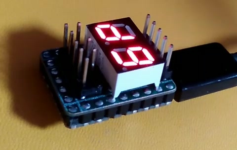

# PicoPost Bill of Materials (BOM)

  

| Ref Des | Component / Value | Package / Footprint | Qty | Description / Recommendation |
|:---|:---|:---|:---:|:---|
| **U1** | RP2040-Zero | SMD Castellated Module | 1 | Waveshare RP2040-Zero or pin-compatible clone |
| **U2** | 2-Digit 7-Segment Display | 10-Pin 15x14mm or 15x10mm | 1 | Models: 2281BY, KL2821B, E20281I, E20281L (Common Cathode or Anode) |
| **R1–R10** | 36 Ω (or 33 Ω – 68 Ω) | 0805 SMD | 10 | Current-limiting resistors for 7-segment display segments |
| **D1–D3** | 1N5819WS (or BAT54, SS14) | SOD-323 SMD | 3 | Schottky barrier diodes for power multiplexing / reverse protection |
| **J1** | 2x5 Pin Header (Optional) | 2.54mm SMD / THT | 1 | Optional header for external 7-segment display module |
| **J2** | 1x5 Pin Header | 2.54mm Vertical THT | 1 | UART header for debug logging |
| **J3** | 2x5 Pin Header | 2.54mm Vertical THT | 1 | Standard LPC bus connector |

### Assembly Notes
1. **Diodes**: Ensure correct polarity orientation of SOD-323 cathode stripes (matches schematic `K` pin).
2. **Resistors**: Standard 0805 SMD resistors, 36 Ω recommended for bright crisp segments at 3.3V logic, but 33 Ω to 68 Ω also work well.
3. **RP2040-Zero**: Solder using castellated edge pads. The board is designed so the module sits flat.
4. **Enclosure**: Can be 3D printed (FDM or SLA) to protect the module during diagnostics.
