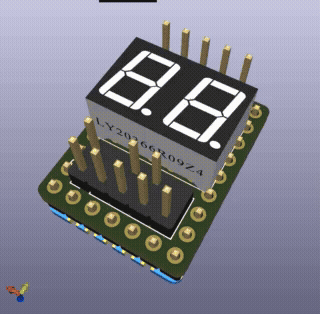

# PicoPost 3D Printable Enclosure (Корпус)

  

Файл 3D-модели корпуса для защиты платы и индикатора PicoPost.

## Файлы
- **`PicoPost_Case.step`** — Твердотельная 3D-модель (STEP AP214) для 3D-печати и редактирования в CAD (SolidWorks, FreeCAD, Fusion 360, Onshape).

## Рекомендации по 3D-печати:
- **Совместимые слайсеры:** Bambu Studio, OrcaSlicer, PrusaSlicer, SuperSlicer, Cura (все современные слайсеры поддерживают импорт файлов `.step` напрямую).
- **Материал:** PETG, PLA, ABS или Resin (фотополимер). Для ремонтных условий рекомендуется термостойкий **PETG** или **ABS**.
- **Высота слоя:** 0.16 – 0.20 мм (для аккуратной посадки разъёмов и дисплея).
- **Заполнение (Infill):** 20% – 30% (Grid или Gyroid).
- **Поддержки (Supports):** Рекомендуются древовидные (Tree / Organic) под вырезы разъемов.
